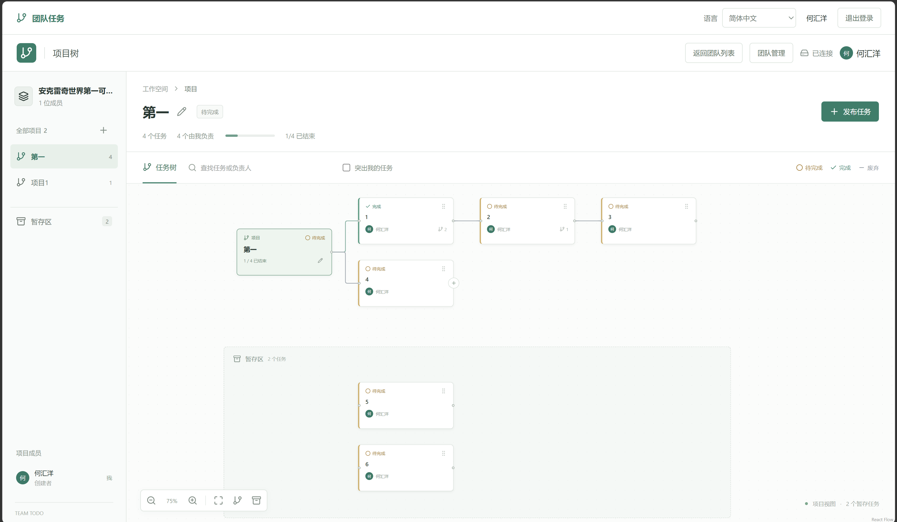
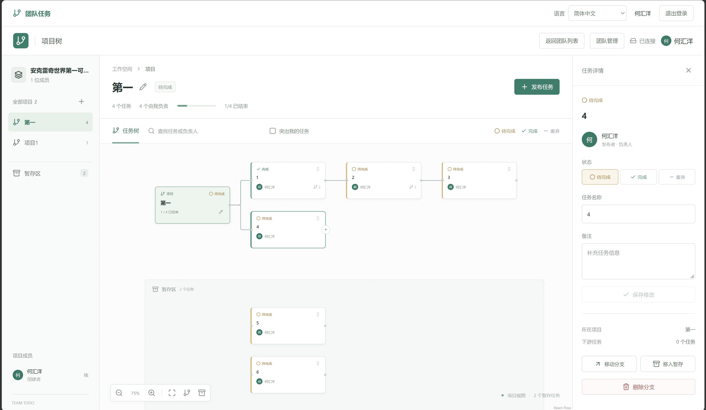
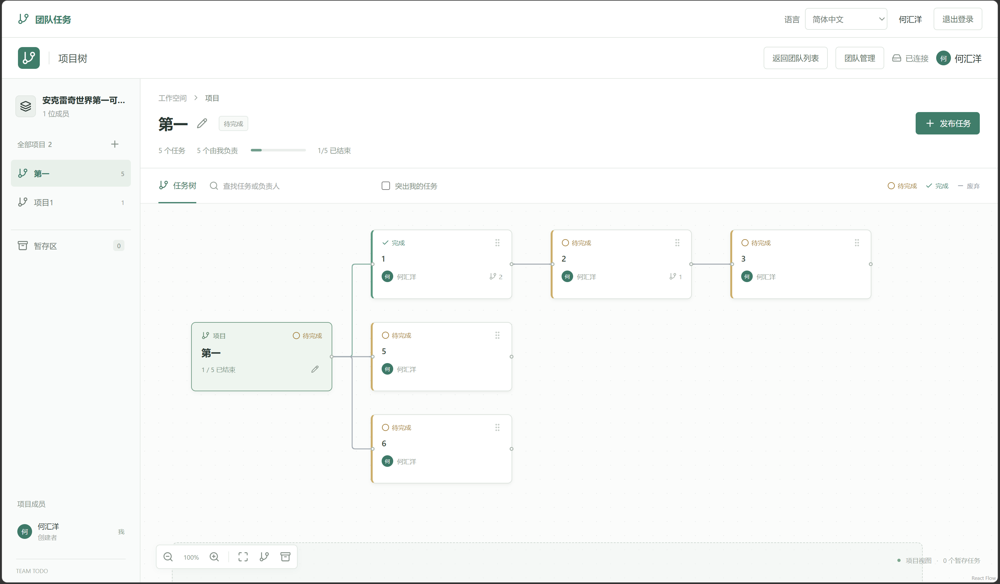
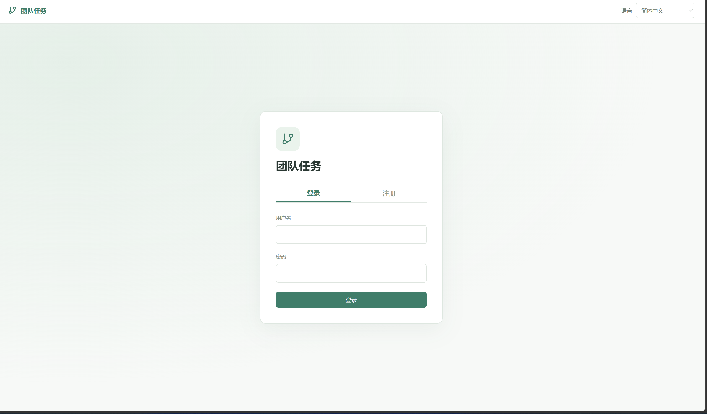
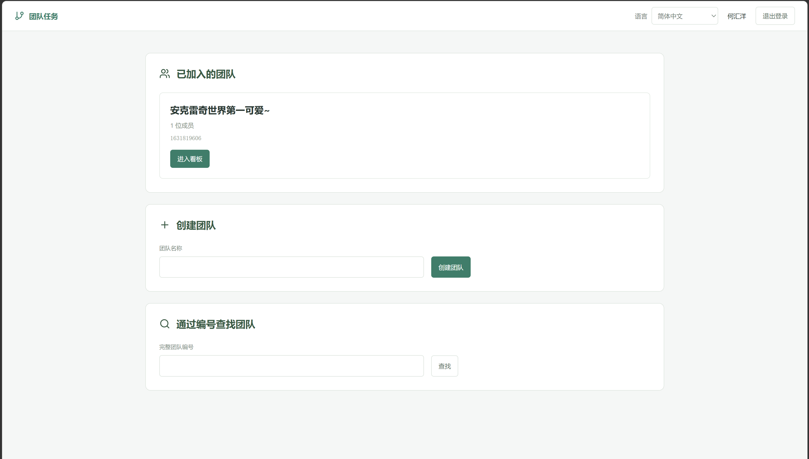

# Team Todo · 团队项目进度

[English](README.md) | 简体中文

## 功能

**用灵活的任务树快速搭建项目，让团队进度一目了然。**

- **任务树自由拆解**：创建多个项目，逐层添加任务与子任务，根据实际工作调整结构。
- **进度直观可见**：查看任务状态、项目进度和上下级关系，快速理解项目做到哪一步。
- **灵活整理任务**：支持共享暂存区和整条分支移动，零散事项可以先记录，再归入项目或其他任务。
- **轻量独立部署**：使用 SQLite 存储，无需飞书、Muse、大模型、邮箱或第三方身份服务。
- **团队数据自行掌握**：部署在自己的服务器；注册账号后，通过完整十位团队码申请加入，由现有成员审批，不公开企业团队目录。
- **成员与权限隔离**：各团队的项目、成员和任务独立，成员移除后在后续请求中失去访问权限；任务编辑遵循作者权限。

例如：创建“产品发布”，拆成“设计 / 开发 / 测试”，再继续细分；任务关系变化时直接移动整条分支，项目进度随任务状态更新。
这是项目协作看板，当前版本不包含定时提醒、截止时间或周报。

### 项目全貌：任务关系与进度一起看

项目、任务和子任务用连线组成任务树，每张卡片展示状态和负责人。顶部汇总任务数量及已结束比例，左侧可以切换项目。

[](docs/images/team-task-tree.png)

### 共享暂存区：先收集，再整理

暂时还没决定放在哪里的任务，可以先放入暂存区，再根据项目安排移动整条分支。图中项目与暂存区同时展示，待整理事项清楚可见。

[](docs/images/team-task-staging.png)

### 任务详情：状态、备注与分支操作

点击任务卡片，在右侧查看负责人、任务状态和备注；有相应权限时，可以修改任务、移动分支、移入暂存区或删除分支。

[](docs/images/team-task-details.png)

### 灵活调整结构，持续跟进项目

任务可以从暂存区重新整理进项目，也可以调整上下级关系。下面展示整理后的任务树：暂存区已清空，项目内五个任务的关系与进度集中呈现。

[](docs/images/team-task-reorganized.png)

点击图片可查看原图。

<details>
<summary>查看登录、创建团队和加入团队的界面</summary>

**登录与注册**：使用本地账号进入应用，界面语言可以独立选择。

[](docs/images/team-login.png)

**团队入口**：查看已加入的团队、创建新团队，或输入完整团队编号查找并申请加入。

[](docs/images/team-workspace.png)

</details>

## 下载

**[下载团队项目进度安装包 · team-todo-setup.exe](https://github.com/there-is-a-spirit-in-the-abyss/team-todo/releases/latest/download/team-todo-setup.exe)**

[全部版本与校验文件](https://github.com/there-is-a-spirit-in-the-abyss/team-todo/releases) · [GitHub 项目地址](https://github.com/there-is-a-spirit-in-the-abyss/team-todo)

下载后双击即可打开部署向导，电脑无需另外安装 Python、Node.js 或 SSH。
仓库目前为私有，下载安装包需要登录有访问权限的 GitHub 账号。

## 安装与部署

**填好服务器连接信息与访问地址，点击部署，安装器自动完成服务器上的安装。**

1. 准备一台可通过 SSH 连接的 Linux 服务器，打开 `team-todo-setup.exe`。
2. 填写服务器 IP 或域名、SSH 端口、用户名及密码或私钥，连接并检查服务器。
3. 选择安装目录（默认 `/team-todo`），填写网页访问地址，确认 HTTPS 或 HTTP 配置。
4. 点击部署。安装器检查环境，安装缺失且受支持的 Docker/Compose，并启动应用；不需要飞书或模型密钥。
5. 打开部署后的网页，注册账号，创建团队与项目，或使用完整团队码申请加入。

使用 HTTPS 时，需准备可用的访问地址并放通证书验证所需端口。部署完成后，团队成员访问同一个网页地址共享数据。

[安装器详细说明](installer/README.md)

<details>
<summary>手动部署、团队权限、语言与备份维护</summary>

### 使用 Docker 快速启动

Windows 用户可以使用[中文图形安装器](installer/README.md)。安装器已包含客户端依赖，
自动连接服务器并完成部署，无需飞书或模型凭据。

手动部署时，先安装带有 Compose 的 Docker，再在项目目录执行：

```sh
docker compose up --build -d
```

打开 **http://localhost:8000**，注册自己的账号。
首次安装没有预置用户、团队、项目或任务。数据保存在 `team-data` 命名卷中，
容器重启和重建后仍保留。`docker compose down -v` 会删除该安装的数据卷，
只有明确需要删除数据时才使用。

服务器部署时，将 `.env.example` 复制为 `.env`，将 `PUBLIC_URL` 设置为实际访问地址，
例如 `https://tasks.example.com`，协议、主机名和端口必须完全一致。
应用仅监听本机回环地址，由 HTTPS 反向代理转发访问；也可以使用 SSH 隧道。
反向代理应保留 `Host`，并将请求转发到 `127.0.0.1:8000`。
每次修改操作都会检查请求来源，HTTPS 部署会自动使用安全会话 Cookie。

### 团队与任务规则

每套安装对应一个企业。使用唯一用户名、密码和显示名称注册，无需邮箱。
一个用户可以加入多个团队。登录后有三个入口：我的团队、创建团队和搜索团队。
搜索只接受完整的十位团队码，不公开企业目录。搜索结果会显示可申请、待审批或已加入；
申请被拒绝后可以再次申请。

团队中的每位当前成员都可以批准或拒绝入队申请。
只有当前创建者可以移除成员、转让团队或解散团队。
普通成员可以退出，创建者退出前需要先转让团队。
被移除的成员在后续请求中立即失去访问权限。
各团队的成员、项目、任务树和暂存区相互独立。

- 任何成员都可以创建项目和任务，任务始终保留原作者。
- 只有作者可以编辑任务、修改状态或删除任务分支。删除分支会同时删除其中由其他人
  创建的子任务，确认窗口会列出受影响内容。
- 所有成员都可以将完整分支移动到项目、其他任务或暂存区。系统拒绝形成循环，
  并保留分支内部的父子关系。
- 作者退群后，其任务可以由剩余成员维护。作者重新加入后，看到最新任务状态并恢复权限。
- 项目进度将已完成和已放弃任务视为结束。项目状态根据任务计算。
  从未使用的空项目会保留，曾经有任务的项目在清空后自动消失。
- 团队创建者没有额外的任务编辑权限。此版本不包含截止时间、提醒或周报功能。

多人同时修改时，过期版本会返回冲突，不会覆盖较新的内容；页面会刷新最新任务板供确认。

### 语言设置

应用默认使用美式英文（`en-US`），可以切换为简体中文（`zh-CN`）、
西班牙语（`es`）、巴西葡萄牙语（`pt-BR`）或德语（`de`）。
登录前即可切换语言，设置会保存在浏览器中；登录后也会保存到账号。
切换语言只影响界面文字，成员姓名、团队与项目名称、任务标题和备注均保持原样。

### 本地 Python 开发

需要 Python 3.11 及以上版本，以及用于构建前端的 Node.js 22 及以上版本。

```sh
python -m venv .venv
```

激活虚拟环境：Windows 执行 `.venv\Scripts\activate`，
Linux 或 macOS 执行 `source .venv/bin/activate`，然后继续执行：

```sh
python -m pip install '.[test]'
cd web
npm ci
npm run build
cd ..
python -m uvicorn team_todo.app:app --host 127.0.0.1 --port 8000
```

本地默认配置为 `PUBLIC_URL=http://localhost:8000`、
`DATABASE_PATH=data/team-todo.db` 和 `STATIC_DIR=web/dist`。
Python 应用通过环境变量读取配置，不会自动加载 `.env`；Compose 会读取 `.env` 进行变量替换。

使用 Vite 开发时，将后端 `PUBLIC_URL` 设置为 `http://127.0.0.1:5173`，
在 8000 端口启动后端，在 `web` 目录执行 `npm run dev`，并打开上述地址。
Vite 会将 `/api` 请求代理到后端。

### 密码恢复与备份

服务器管理员可以在本机重置用户密码。系统会私下提示输入密码，重置后撤销该用户的全部会话：

```sh
docker compose exec app python -m team_todo.manage reset-password USERNAME
```

本地运行时使用 `python -m team_todo.manage reset-password USERNAME`。
自动化管理可添加 `--password-stdin`，从标准输入读取一行密码。
避免将真实密码放入命令行或提交到文件中。

创建在线一致性 SQLite 备份：

```sh
docker compose exec app python -m team_todo.manage backup /app/data/backup.db
docker compose cp app:/app/data/backup.db ./backup.db
```

本地运行时使用 `python -m team_todo.manage backup /absolute/path/backup.db`。
备份可能包含私有业务数据，应与源码仓库分开保管。
恢复前停止应用、保留当前数据库，再用一致性备份替换；
不要将旧数据库的 WAL 或 SHM 文件与恢复后的数据库混用。
文件权限应允许容器中的用户标识 10001 读写恢复文件。

### 验证与源码交付

```sh
python -m pytest
cd web
npm test
npm run build
npm run test:e2e
```

浏览器测试需要 Chromium，可在 `web` 目录执行 `npx playwright install chromium` 安装。
测试通过真实接口操作虚构账号。应另行在 8000 端口启动测试后端，设置
`PUBLIC_URL=http://127.0.0.1:8791` 和 `DATABASE_PATH=.runtime/browser-test.db`，
然后在 `web` 中执行浏览器测试。Playwright 会在 8791 端口启动独立的 Vite 服务。
每次测试使用全新数据库，不能指向实际安装的数据。
例如，在项目根目录另外打开一个 PowerShell 终端：

```powershell
$env:PUBLIC_URL='http://127.0.0.1:8791'
$env:DATABASE_PATH='.runtime/browser-test.db'
.\.venv\Scripts\python -m uvicorn team_todo.app:app --host 127.0.0.1 --port 8000
```

已验证结果及环境限制记录在[验证报告](docs/VERIFICATION.md)，
实现约定见[设计文档](docs/DESIGN.md)。
源码交付不包含数据库、真实凭据、`.env`、运行日志、依赖目录和构建缓存。
自动化测试使用临时数据，不会安装演示账号或生产账号。
源码和 Windows 安装包通过本页顶部的仓库及发布页提供。

</details>
